# Chengzhang for Even G2

**Think it, say it.** Talk an article into existence on your glasses, then settle the AI's notes with a tap.

[中文说明](README.zh-CN.md) · Built for *Heads Up: Even Realities Hackathon* · Track 04, AI Assistants & Work (Claude, OpenRouter, Notion)

| On the glasses | On the phone |
|---|---|
| 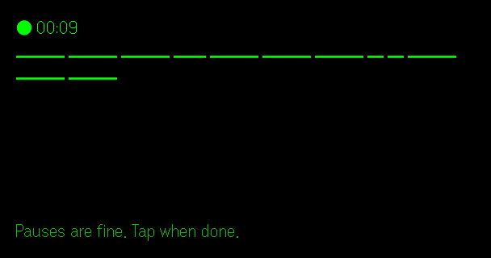 | 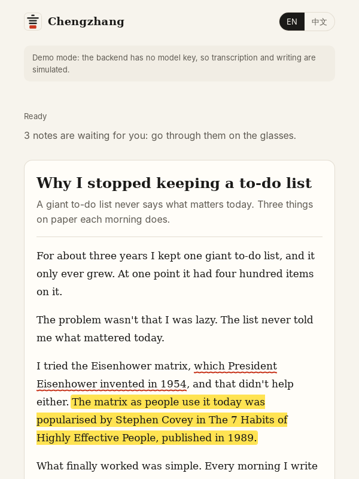 |
| 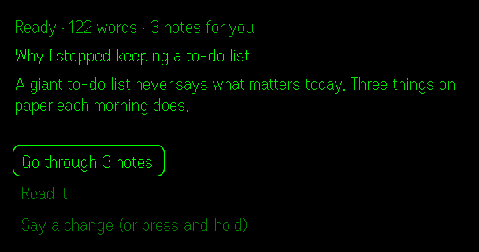 | |

## The moment it is for

An idea arrives when your hands are busy: on a walk, on the way out of a meeting, cooking. By the time you are at a keyboard it has gone flat.

With Chengzhang you tap the temple and think out loud. Pauses, repeats and changes of mind are fine. A minute or two later the glasses show a title and one line saying what the article says. Claude has turned the talking into a draft in your voice, checked the checkable claims on the web, and left you a short list of things only you can decide.

You go through that list without taking your phone out:

- **A sentence the AI added** (with its source): keep it or remove it. One tap.
- **Something you said that disagrees with a source**: leave it as you said, or use the correction. One tap. It is never changed silently.
- **A question the article needs answered**: answer out loud, in one sentence.

Then, if something still reads wrong, press and hold and say so: "make the opening more direct." The change is applied; "Undo" is the next item in the list.

The article is waiting on the phone, typeset, ready to copy as Markdown or send to Notion.

## What it looks like

| | |
|---|---|
| 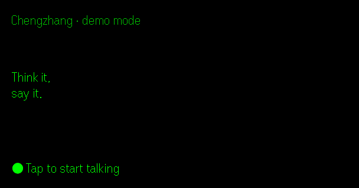<br>**Open.** A blank page and one thing to do. | <br>**Talk.** No words appear, only ink, so there is nothing to go back and fix. |
| 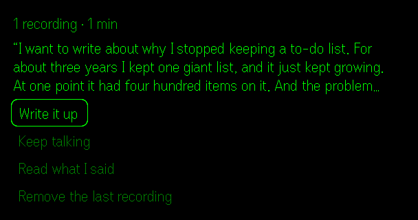<br>**What you said**, cleaned of filler. Write it up when you are ready, or keep talking. | 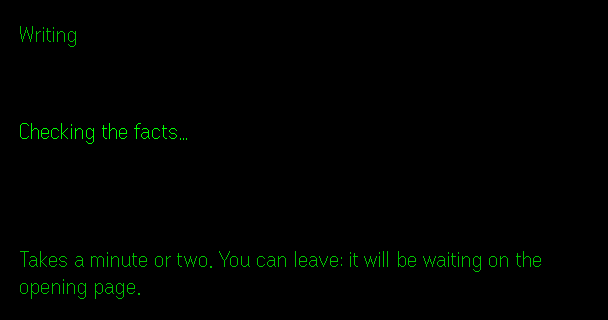<br>**Writing** takes a minute or two. You can leave. |
| <br>**Ready.** The point of the article in one glance. | 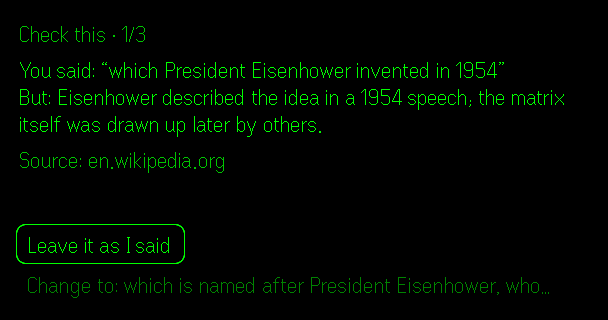<br>**Check this.** Your words stay unless you say otherwise. |
| 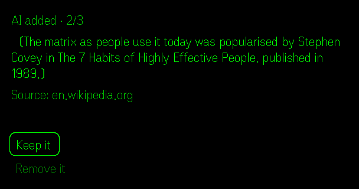<br>**AI added.** Always with a source; yours to keep or remove. | 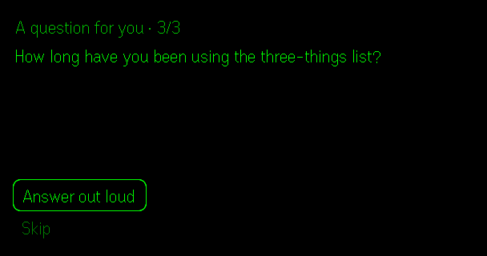<br>**A question for you.** Answer out loud. |
| 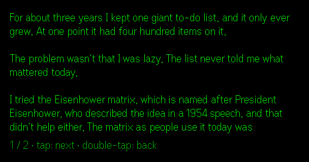<br>**Read it**, a page at a time. | 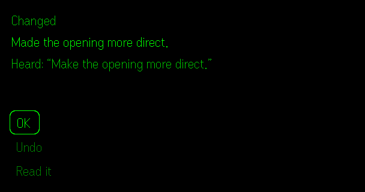<br>**Say a change.** You see what was heard and what was done, and can undo it. |

Every screen in both languages is in [docs/screens](docs/screens); they are produced by `npm run e2e`, not drawn by hand.

### Controls

| Gesture (temple or R1 ring) | What it does |
|---|---|
| Tap | Choose the highlighted item, turn the page, or finish talking |
| Swipe up / down | Move through a list or the pages |
| Double-tap | Go back. On the opening page: the system's exit dialog |
| Press and hold | On a finished article: say a change, let go when done. On a question: answer it |

## The rules it follows

Chengzhang is an existing writing tool ([chengzhang.ink](https://chengzhang.ink)); this is its glasses edition, and it keeps the product's rules:

1. **The article says what you said.** The AI organises your points in your voice. It does not add opinions or examples.
2. **Anything the AI adds has a real source, and is marked.** The backend deletes any added sentence whose source is not a page the fact check actually returned ([`reconcile`](server/pipeline.ts)).
3. **Where you and a source disagree, it tells you and changes nothing.**
4. **You decide.** Every note can be kept, removed or answered, and every change can be undone.
5. **No words while you talk.** Seeing a transcript makes people edit instead of think. You get ink.
6. **Writing starts when you say so**, and happens in the background. Nothing on screen makes you wait.
7. **Two colours on paper, each with one meaning** (phone page): red is your voice, the highlight is the AI's addition. The glasses have one colour, so brightness does that job: content is bright, guidance is dim.

## Try it

You need Node.js 22.13 or newer. No glasses and no API key are needed for a first look.

```bash
npm install
```

```bash
npm run dev
```

In a second terminal, open the simulator:

```bash
npm run sim
```

With no key configured the backend runs in **demo mode**: transcription and writing are simulated with a canned example, so you can walk the whole flow with the simulator's controls (tap, double tap, up, down, long press).

No microphone on your machine? Add `?mic=demo` to the address (`http://localhost:5173/?mic=demo`) and the app feeds itself speech-shaped noise. `?lang=zh` switches the interface to Chinese.

### With real models

```bash
cp .env.example .env
```

Put an `OPENROUTER_API_KEY` in `.env` and restart `npm run dev`. One OpenRouter key covers both transcription (Qwen ASR) and writing (Claude). To call Anthropic directly for writing, set `ANTHROPIC_API_KEY` as well. All settings are listed in [.env.example](.env.example).

Transcription can also go through Alibaba Cloud Model Studio (`STT_PROVIDER=dashscope`). If only one of the two halves has a key, that half is real and the other is simulated, and the phone page says which.

### On real glasses

With `npm run dev` running, and the phone on the same network as your computer:

```bash
npx evenhub qr --url http://YOUR-LAN-IP:5173
```

Scan the code from the Even Realities app (developer mode). The dev server forwards `/api` to the backend, so nothing else needs configuring.

### Deploying, and packing an .ehpk

The backend also serves the built app, so one Node process is the whole deployment:

```bash
npm ci && npm run build && npm start
```

Or with Docker: `docker build -t chengzhang-g2 .`, then `docker run -p 8787:8787 -v chengzhang-data:/app/data --env-file .env chengzhang-g2`.

Set `ACCESS_CODE` on any server other people can reach: a new device then has to enter the code once, on the phone page, before it can use your keys. Use a host with a persistent disk for `DATA_DIR` (one SQLite file), and run a single instance: writing happens inside the process.

Then build the app against that address and pack it:

```bash
API_ORIGIN=https://your-backend.example.com npm run pack
```

This writes `chengzhang-0.1.0.ehpk`, with the backend's origin in the manifest's network whitelist. The 24 × 24 store icon is `public/icon.png`.

## How it is built

```
 Even G2 glasses            phone: Even Realities app               your server
┌────────────────┐  BLE  ┌───────────────────────────────┐ HTTPS ┌────────────────────────────┐
│ text + list    │◀─────▶│ WebView: this app (src/)      │◀─────▶│ backend (server/)          │
│ containers,    │       │  · screens for the glasses    │       │  · slices → speech-to-text │
│ touch, mic     │       │  · paper-and-ink phone page   │       │  · tidy, fact-check, write │
└────────────────┘       │  · records, slices, uploads   │       │  · SQLite, device tokens   │
                         └───────────────────────────────┘       └─────────────┬──────────────┘
                                                                               │
                                             OpenRouter (Qwen ASR) · Claude (Anthropic or OpenRouter) · Notion
```

- **The glasses do not render HTML.** A screen is a few text and list boxes at pixel positions on a 576 × 288 canvas. [`src/glasses/display.ts`](src/glasses/display.ts) takes a description of the wanted screen and sends the cheapest update: text in place when only words changed, a rebuild when the layout did. Text is measured with the firmware's glyph widths before it is sent, so nothing overflows ([`layout.ts`](src/glasses/layout.ts)).
- **Audio never waits for the end.** The microphone stream is cut into slices of about 15 seconds at a pause and uploaded while you are still talking ([`src/audio.ts`](src/audio.ts)), so most of it is transcribed by the time you tap "done". Slices are kept on the phone until the backend has them, and on the backend only until they are transcribed.
- **Writing is three Claude calls** ([`server/pipeline.ts`](server/pipeline.ts), prompts in [`server/prompts.ts`](server/prompts.ts)): *tidy* each recording (low effort), *fact-check* with Claude's web search (Claude Sonnet 5.5), then *write* with structured output (Claude Opus 5.5). A spoken change is one more call.
- **The phone page moves in one language.** The page is re-rendered as HTML on every change; [`src/phone/motion.ts`](src/phone/motion.ts) works out what happened to each element and shows exactly that. What stayed glides to its new place, what is new rises in, what left fades where it stood, and a box that grew or shrank moves its edge while its buttons ride on it. Old and new words are never legible on top of each other: out, then in. Three durations (120, 260 and 420 ms) and three curves cover every change, and they are defined once. Apart from the height of two boxes, only transform and opacity animate. Positions are measured as they look on screen, so a change that arrives mid-flight continues from there. The page follows the system's light or dark appearance, uses two columns on a wide window, and with "reduce motion" on nothing travels or loops.
- **The glasses cannot animate, so they hold still instead.** The same idea there means changing text in place and never redrawing what did not change: from talking to saving, the clock and the ink stay where they were and only the dot goes hollow.
- **No keys in the app.** The WebView only knows the backend's address and a random device token. Model keys live on the server.
- **It survives being closed.** The app remembers which article was open; a recording interrupted by closing the app is finished from the slices already uploaded; work interrupted by a server restart is reported as such, not left spinning.

```
src/            the app that runs in the Even app's WebView
  app.ts          which screen is showing and what a tap does there
  audio.ts        recording: loudness, slicing, upload with retry
  glasses/        display (containers), layout (measuring), screens, ink, input
  phone/          the paper-and-ink page on the phone, and how it moves (motion.ts)
server/         the backend: API, speech-to-text, Claude, prompts, storage, Notion
shared/         types and the article format, used by both sides
tests/          unit tests, and the whole backend flow in memory
dev/            a storyboard: every state of the phone page, with canned data
scripts/e2e.ts            walks every screen in the simulator and saves the pictures
scripts/motion-check.ts   measures how the phone page moves
```

## Tests

```bash
npm test
```

34 tests, no keys or network needed: the article format, measuring and paging for the glasses, input decoding, the recorder, speech-to-text against a provider that is busy or refusing (a busy one is asked again, so a take is not lost to a rate limit), and the complete backend flow (talk, write, decide each note, answer by voice, change, undo) run in memory against the simulated AI.

```bash
npm run e2e
```

Starts its own backend, dev server and simulator, then drives the app through every screen with the simulator's automation API, the way a person would with the touchpad, and saves each screen to `docs/screens`. On Linux without a display it uses `xvfb-run`. `LANG_UI=zh npm run e2e` walks the Chinese interface.

```bash
npm run motion
```

Measures how the phone page moves, in headless Chromium, against a storyboard of its 31 states (`dev/storyboard.html`, also handy to look at: `http://localhost:5173/dev/storyboard.html?play=1`). It needs Playwright: `npm i --no-save playwright && npx playwright install chromium`.

| What it checks | Last run |
|---|---|
| Every state at 320, 390, 600 and 1280 px, light and dark, both languages: nothing overflows sideways, sticks out of its box, or is left behind by a transition | 496 visits, clean |
| Frame times through every transition with the CPU slowed 4× | 1,301 frames, none late |
| The same with an article of 200 paragraphs | 1,290 frames, one late (33 ms) |
| Changing state every 50 ms, mid-animation, then stopping | identical to going there directly |
| With "reduce motion" on | nothing travels, nothing loops |

## Privacy and safety

- The microphone is on only between "start" and "done". There is no background listening.
- Audio is deleted from the server as soon as it is transcribed; only the words are kept.
- No accounts, analytics or ads. A device is known by a random token.
- Daily limits per device (audio minutes, articles, changes) cap what a shared deployment can spend.
- Everything the model or the speech recogniser returns is escaped before it reaches the phone page.

Details in [PRIVACY.md](PRIVACY.md).

## For the hackathon

**Track.** 04, AI Assistants & Work. The core integration is Claude (through the Anthropic API or OpenRouter): tidying, web fact-checking, writing with structured output, and editing from a spoken instruction. Notion is the optional destination for the finished article.

**Read and write.** Reading is one glance: a title and what the article says. Writing back is a tap (keep, remove, use the correction, undo) or one spoken sentence (answer a question, ask for a change). The first item in every list is the safe default, so the common path is tap, tap, tap.

**What existed before November 23.** Chengzhang itself: the product idea, the name and mark, the paper-and-ink look and the rules listed above, which belong to an existing web app whose code is private and not in this repository. Everything here (the G2 app, the backend, the prompts, the tests) was written during the hackathon and shares no code with the web app. It uses the same model providers.

**Not verified yet.**

- Speech-to-text has been run for real through Alibaba Cloud Model Studio (`qwen3-asr-flash`, `STT_PROVIDER=dashscope`): a 44-second take, a spoken answer and a spoken change, through the whole backend. The OpenRouter transcription route and every Claude call (through OpenRouter or Anthropic) are written to the providers' documented request formats but have not been run: the writing steps have so far only run with the simulated AI, and the prompts have not been tuned on real recordings.
- It has been run in the Even Hub simulator only, not on G2 hardware. Timing of page rebuilds over Bluetooth, the microphone's levels, and behaviour with the phone locked need a real device.
- "Send to Notion" is implemented against Notion's documented API and its Markdown conversion is tested, but it has not been run against a live workspace.

**Feedback for the Even Hub SDK**, from building this:

1. No text alignment and a single font size. One "large" size would make titles glanceable.
2. List rows cannot be updated in place; changing one row rebuilds the page.
3. The app cannot ask which list row is selected, so the phone page cannot mirror the selection.
4. The SDK logs every event to the console, including ten microphone frames a second, and has no switch to turn that off.
