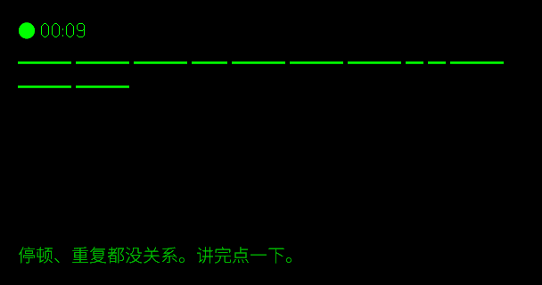
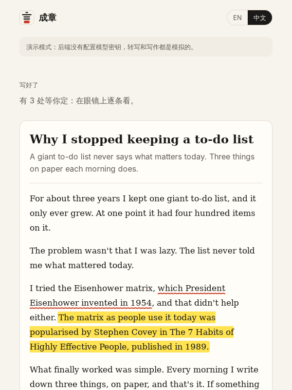
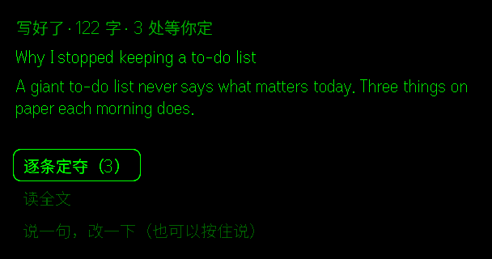
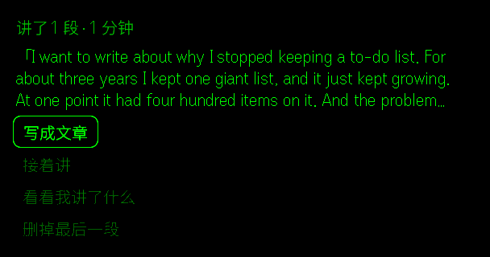
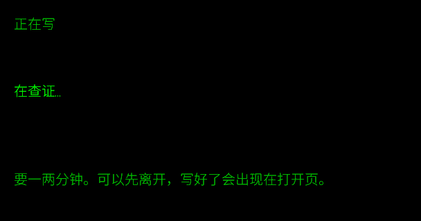
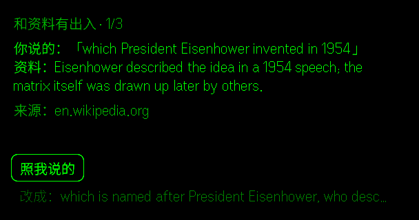
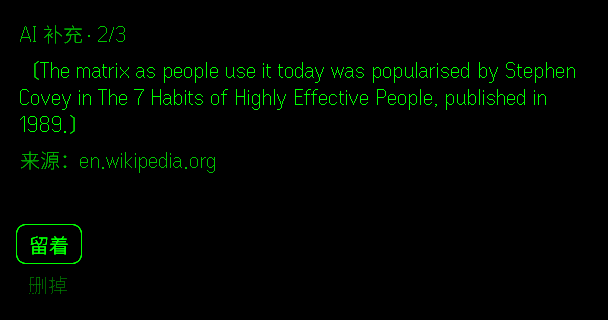
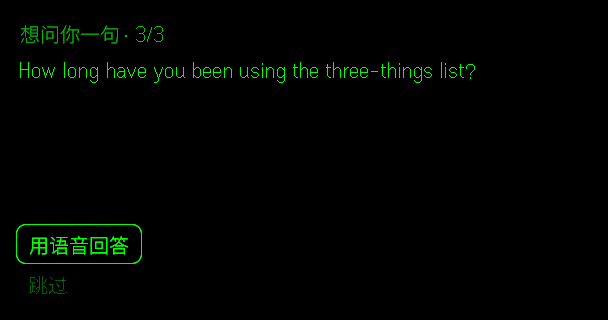
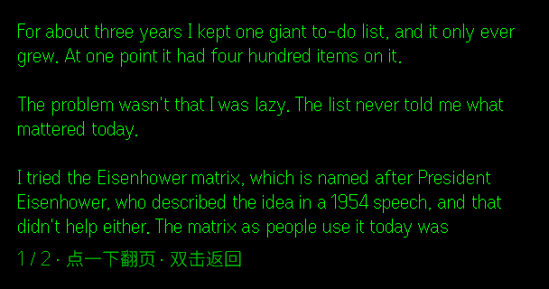
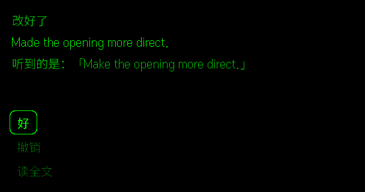

# 成章 · Even G2 版

**想到哪，讲到哪。** 在眼镜上把一篇文章讲出来，AI 留下的每一处，点一下就定了。

[English](README.md) · 参加 *Heads Up: Even Realities Hackathon* · 赛道 04：AI Assistants & Work（Claude、OpenRouter、Notion）

| 眼镜上 | 手机上 |
|---|---|
|  |  |
|  | |

## 它用在什么时候

想法常常在腾不出手的时候来：走路、刚出会议室、做饭。等坐到键盘前，已经凉了。

用成章，轻点镜腿，把想法讲出来。停顿、重复、说到一半改口都没关系。一两分钟后，眼镜上出现标题和一句话的大意：Claude 已经按你的口吻把口述写成了初稿，联网核对了能核对的地方，并留下一份只有你能定的清单。

清单不用掏手机就能过完：

- **AI 补充的句子**（带来源）：留着，或删掉。点一下。
- **你说的和资料有出入**：照你说的，或按资料改。点一下。它不会悄悄替你改。
- **文章缺的一句**：直接用语音回答。

哪里还不顺，按住镜腿说一句「开头再直接一点」，改完能看到听到了什么、改了什么，下一项就是「撤销」。

文章同时在手机上排好了版，可以复制成 Markdown，或者发到 Notion。

## 长什么样

| | |
|---|---|
| <br>**打开。** 一张空白页，一件可以做的事。 | <br>**讲。** 屏幕上不出字，只有墨痕，没有可以回头改的东西。 |
| <br>**素材。** 去掉了口头语。想好了就「写成文章」，或者接着讲。 | <br>**正在写。** 要一两分钟，可以先离开。 |
| <br>**写好了。** 一眼看到文章讲了什么。 | <br>**和资料有出入。** 你不点头，原话不动。 |
| <br>**AI 补充。** 一定带来源，留不留你说了算。 | <br>**想问你一句。** 用语音回答。 |
| <br>**读全文**，一页一页翻。 | <br>**说一句，改一下。** 看得到听到了什么、改了什么，可以撤销。 |

两种语言的全部画面在 [docs/screens](docs/screens)，是 `npm run e2e` 在模拟器里走出来的，不是画的。（演示模式的示例内容是英文的；接上真实模型后，你讲什么语言，文章就是什么语言。）

### 怎么操作

| 手势（镜腿或 R1 戒指） | 作用 |
|---|---|
| 点一下 | 选中高亮的一项、翻页、讲完了 |
| 上下滑 | 在列表或页面之间移动 |
| 双击 | 返回。在打开页上是系统的退出确认 |
| 按住 | 在写好的文章上：说一句要怎么改，说完松手。在提问上：回答它 |

## 它守的规矩

成章是一个已有的写作工具（[chengzhang.ink](https://chengzhang.ink)），这是它的眼镜版，规矩和原来一样：

1. **文章写的是你讲的。** AI 用你的口吻把你的观点理顺，不替你加观点、加例子。
2. **AI 加的每一句都有真实来源，并且标出来。** 来源网址不在这次查证实际查到的结果里，后端会把那句话连同批注一起删掉（[`reconcile`](server/pipeline.ts)）。
3. **你说的和资料对不上时，只提示，不替你改。**
4. **你拍板。** 每一处都可以留、删、回答；每一次改动都可以撤销。
5. **讲的时候不出字。** 看到转写的字，人会去改字而不是接着想。屏幕上只有墨痕。
6. **你点了才开始写**，而且在后台写，不用盯着等。
7. **纸、墨，加两种颜色，各只有一个意思**（手机页面）：朱红是你的声音，亮色是 AI 加的。眼镜只有一种颜色，就用明暗区分：内容亮，提示暗。

## 跑起来

需要 Node.js 22.13 或更新的版本。第一次看不需要眼镜，也不需要密钥。

```bash
npm install
```

```bash
npm run dev
```

另开一个终端，打开模拟器：

```bash
npm run sim
```

没配密钥时后端是**演示模式**：转写和写作用一份固定的示例模拟，整条流程都能走。用模拟器的点击、双击、上、下、长按来操作。

电脑没有麦克风？在地址后面加 `?mic=demo`（`http://localhost:5173/?mic=demo`），应用会自己产生像说话一样的声音。`?lang=zh` 把界面切成中文。

### 接上真实模型

```bash
cp .env.example .env
```

在 `.env` 里填 `OPENROUTER_API_KEY`，重启 `npm run dev`。一把 OpenRouter 的 key 同时管转写（千问语音识别）和写作（Claude）。想让写作直连 Anthropic，再填 `ANTHROPIC_API_KEY`。转写也可以改用阿里云百炼（`STT_PROVIDER=dashscope`）。全部配置见 [.env.example](.env.example)。

转写和写作如果只配了其中一半的密钥，配了的那一半是真的，另一半是模拟的，手机页面上会写明是哪一半。

### 在真眼镜上

`npm run dev` 开着，手机和电脑在同一个网络：

```bash
npx evenhub qr --url http://你的局域网IP:5173
```

在 Even Realities App（开发者模式）里扫码。开发服务器会把 `/api` 转给后端，不用再配别的。

### 部署，和打包 .ehpk

后端同时提供构建好的应用，所以一个 Node 进程就是全部：

```bash
npm ci && npm run build && npm start
```

也可以用 Docker：`docker build -t chengzhang-g2 .`，然后 `docker run -p 8787:8787 -v chengzhang-data:/app/data --env-file .env chengzhang-g2`。

别人能访问到的服务器上请设置 `ACCESS_CODE`：新设备要先在手机页面上填一次访问码，才能用你的密钥。`DATA_DIR`（一个 SQLite 文件）要放在不会丢的磁盘上；只跑一个实例，因为写作任务在进程里跑。

然后针对这个地址构建并打包：

```bash
API_ORIGIN=https://你的后端地址 npm run pack
```

得到 `chengzhang-0.1.0.ehpk`，后端地址已经写进清单的网络白名单。24 × 24 的商店图标是 `public/icon.png`。

## 怎么做的

```
 Even G2 眼镜              手机：Even Realities App                 你的服务器
┌────────────────┐  蓝牙  ┌───────────────────────────────┐ HTTPS ┌────────────────────────────┐
│ 文本和列表容器 │◀─────▶│ WebView：这个应用（src/）     │◀─────▶│ 后端（server/）            │
│ 触控、麦克风   │       │  · 眼镜上的各个画面           │       │  · 录音分片 → 转写         │
└────────────────┘       │  · 纸墨风格的手机页面         │       │  · 整理、查证、成文        │
                         │  · 录音、分片、上传           │       │  · SQLite、设备令牌        │
                         └───────────────────────────────┘       └─────────────┬──────────────┘
                                                                               │
                                        OpenRouter（千问语音识别）· Claude（Anthropic 或 OpenRouter）· Notion
```

- **眼镜不渲染网页。** 一个画面就是 576 × 288 画布上几个按像素摆放的文本框和列表。[`src/glasses/display.ts`](src/glasses/display.ts) 拿到想要的画面后，发最省的更新：只是字变了就原地改字，版式变了才重建。文字先按固件的字宽量过再发，不会溢出（[`layout.ts`](src/glasses/layout.ts)）。
- **录音不等到最后才传。** 麦克风的声音在停顿处切成大约 15 秒一片，边讲边传（[`src/audio.ts`](src/audio.ts)），点「讲完了」时大部分已经转写好。分片在手机上留到后端收到为止，在后端只留到转写完为止。
- **成文是三次 Claude 调用**（[`server/pipeline.ts`](server/pipeline.ts)，提示词在 [`server/prompts.ts`](server/prompts.ts)）：每段录音先*整理*，然后用 Claude 的联网搜索*查证*（Claude Sonnet 5.5），再用结构化输出*成文*（Claude Opus 5.5）。语音改稿是再一次调用。
- **手机页面的动效只有一套说法。** 页面每次变化都重新生成 HTML；[`src/phone/motion.ts`](src/phone/motion.ts) 算出每个元素到底发生了什么，只把这件事演出来：还在的滑到新位置，新来的升上来，走了的在原地淡出，变大变小的盒子移动边缘，按钮跟着边缘走。新旧文字不会叠在一起：旧的先退，新的再进。所有变化只用三档时长（120、260、420 毫秒）和三条曲线，只定义一次。除了两个盒子的高度，只动 transform 和透明度。位置按屏幕上此刻看到的样子量，所以动画放到一半又来新的变化，会从当前位置接着走。页面跟随系统的深浅色，窗口够宽时分成两栏；打开系统的「减少动态效果」后，没有东西位移，也没有循环动画。
- **眼镜做不了动画，所以它不乱动。** 同样的想法在眼镜上就是原地改字、没变的不重画：从「在讲」到「在保存」，时钟和墨痕留在原处，只有圆点变成空心。
- **应用里没有密钥。** WebView 只知道后端地址和一个随机的设备令牌，模型密钥都在服务器上。
- **关掉也不丢。** 应用记得上次打开的是哪一篇；讲到一半被关掉，会用已经传上去的分片把这段录音收尾；服务器重启打断的任务会明说「被打断了」，不会一直转圈。

```
src/            跑在 Even App 的 WebView 里的应用
  app.ts          现在是哪个画面、在这里点一下会发生什么
  audio.ts        录音：响度、分片、带重试的上传
  glasses/        显示（容器）、排版（量字宽）、各画面、墨痕、输入
  phone/          手机上的纸墨页面，以及它怎么动（motion.ts）
server/         后端：接口、转写、Claude、提示词、存储、Notion
shared/         两边共用的类型和文稿格式
tests/          单元测试，以及在内存里跑完整的后端流程
dev/            故事板：手机页面的每个状态，用固定数据
scripts/e2e.ts            在模拟器里把每个画面走一遍并截图
scripts/motion-check.ts   实测手机页面的动效
```

## 测试

```bash
npm test
```

34 个测试，不需要密钥和网络：文稿格式、眼镜上的量字和分页、输入解码、录音模块、转写服务繁忙或拒绝时的表现（繁忙会重试，一段录音不会因为限流而丢），以及用模拟 AI 在内存里跑的完整后端流程（讲、写、逐条定夺、语音回答、改稿、撤销）。

```bash
npm run live
```

用真实的 Claude 把一篇文章在后端走一遍：整理、联网核查、成文、逐条定夺、语音回答、口头改稿、撤销。只有语音转写是模拟的，其余都是真调用；每一步返回了什么、花了多久、用了多少 token，都会打印出来。需要 `ANTHROPIC_API_KEY`（或 `OPENROUTER_API_KEY`）。`LANG_UI=zh npm run live` 用中文界面跑。

```bash
npm run e2e
```

自己启动后端、开发服务器和模拟器，用模拟器的自动化接口像人用触控板那样把每个画面走一遍，并把截图存到 `docs/screens`。Linux 没有显示器时用 `xvfb-run`。`LANG_UI=zh npm run e2e` 走中文界面。

```bash
npm run motion
```

在无头 Chromium 里实测手机页面的动效，对象是一个包含全部 31 个状态的故事板（`dev/storyboard.html`，也可以直接打开看：`http://localhost:5173/dev/storyboard.html?play=1`）。需要 Playwright：`npm i --no-save playwright && npx playwright install chromium`。

| 查什么 | 最近一次结果 |
|---|---|
| 每个状态在 320、390、600、1280 像素宽，深色和浅色，中英文下：没有横向溢出，没有东西伸出自己的盒子，过渡结束后没有残留 | 496 次，全部干净 |
| CPU 降速 4 倍，走完每一个过渡的帧时间 | 1301 帧，没有掉帧 |
| 同上，文章有 200 段 | 1290 帧，1 帧迟到（33 毫秒） |
| 动画进行中每 50 毫秒换一次状态，然后停下 | 和直接到达那个状态完全一样 |
| 打开「减少动态效果」 | 没有位移，没有循环动画 |

## 隐私和安全

- 麦克风只在「开始讲」和「讲完了」之间打开，没有后台监听。
- 录音转写完就从服务器删掉，只留文字。
- 没有账号、统计和广告。设备靠一个随机令牌识别。
- 每台设备每天有上限（录音分钟数、成文篇数、改稿次数），共用的部署花不超。
- 模型和语音识别返回的所有内容，显示到手机页面之前都做了转义。

详见 [PRIVACY.md](PRIVACY.md)。

## 比赛相关

**赛道。** 04，AI Assistants & Work。核心集成是 Claude（经 Anthropic API 或 OpenRouter）：整理、联网查证、结构化输出成文、按一句口述改稿。Notion 是写好的文章可选的去处。

**读和写。** 读是一眼：标题和一句大意。写回去是点一下（留着、删掉、按资料改、撤销）或者说一句话（回答提问、提出修改）。每个列表的第一项都是稳妥的默认选择，所以常见的路径就是点、点、点。

**11 月 23 日之前已有的。** 成章本身：产品想法、名字和标志、纸墨的样子，以及上面列的规矩，属于一个已有的网页应用，它的代码是私有的，不在这个仓库里。这里的一切（G2 应用、后端、提示词、测试）都是比赛期间写的，没有和网页应用共用代码，用的是同样的模型服务商。

**演示视频。** 在 Even Hub 模拟器里一镜到底，手机页面按真实帧率录制。对眼镜说的话是真的转写（千问语音识别）；写作那一步在这次录制里是模拟的，因为录制环境没有 Claude 密钥，视频每一帧上都写明了。写作后来已经用真实 Claude 跑通（见下文和 `npm run live`）。旁白和口述是作者本人的声音，经克隆后合成；配乐是原创。逐场说明见 [docs/SUBMISSION.md](docs/SUBMISSION.md)。

**还没验证的。**

- 语音转写已经用阿里云百炼真实跑过（`qwen3-asr-flash`，`STT_PROVIDER=dashscope`）：一段 44 秒的口述、一句语音回答、一句语音修改，走完了整个后端。经 OpenRouter 的转写还没有跑过。
- 写作已经直连 Anthropic API 真实跑过（`ANTHROPIC_API_KEY`）：整理、改稿和回答用 Claude Opus 5.5，核查用 Claude Sonnet 5.5 加网页搜索，成文用 Claude Opus 5.5 加结构化输出，并打开了服务端兜底（server-side fallback）。`npm run live` 把一篇文章从头到尾走一遍，中英文界面都跑过。不过这几次用的素材都是那段关于待办清单的口述（真实录音转写出来的原文），没有用新的录音，所以提示词只在这一份素材上检查过。经 OpenRouter 调用 Claude 还没有跑过：那边的密钥没有额度了。
- 只在 Even Hub 模拟器里跑过，没有上过 G2 真机。蓝牙下重建页面的快慢、麦克风的音量、手机锁屏时的表现，都要真机才能确认。
- 「发到 Notion」按 Notion 文档的接口实现，Markdown 的转换有测试，但没有对着真实的工作区跑过。

**给 Even Hub SDK 的反馈**（做这个应用时遇到的）：

1. 文本不能对齐，只有一种字号。哪怕多一个「大」字号，标题也能一眼看清。
2. 列表的某一行不能原地更新，改一行要重建整页。
3. 应用问不到列表现在选中的是哪一行，手机页面没法跟着显示。
4. SDK 会把每个事件都打到控制台，包括每秒十帧的麦克风数据，而且关不掉。
