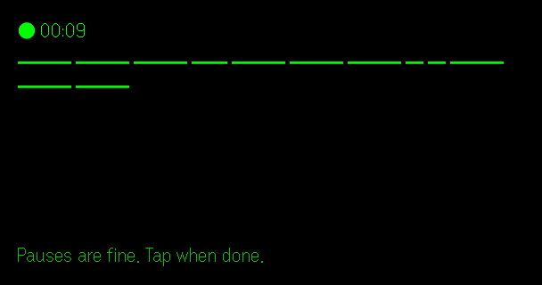
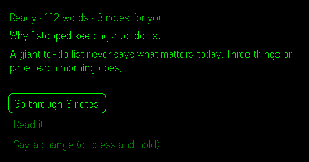
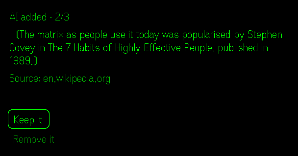

# Submission

The description below is what goes into the DoraHacks "Describe your Build" field, as Markdown. The screenshots load from this repository, so it has to be public. DoraHacks' editor does not render Markdown tables well, so there are none.

---

# Chengzhang for Even G2

**Think it, say it.** Talk an article into existence on your glasses, then settle the AI's notes with a tap.

https://youtu.be/p6uaDYp3txk

**Track 04 · AI Assistants & Work** · Code: [github.com/Nowhitestar/Chengzhang-G2](https://github.com/Nowhitestar/Chengzhang-G2) · Try it on G2: scan the QR code in the README with the Even Realities app (developer mode), access code `heads-up-g2`

## The problem

Good ideas show up when your hands are busy: on a walk, on the way out of a meeting, while cooking. By the time you are at a keyboard they have gone flat. Voice notes and dictation do not fix that. They hand you a wall of raw transcript that you still have to turn into something, and a live transcript on screen makes you stop and fix words instead of thinking.

## How it works

Tap the temple and think out loud. The glasses show a clock and strokes of ink, never words. When you say "write it up", Claude turns the talking into an article in your voice and checks the checkable claims on the web. Then the glasses show the title, one line saying what the article says, and a short list of things only you can decide, each settled with a tap or one spoken sentence.

Under the hood:

- **The glasses.** The app is a web app inside the Even Realities app, talking to the glasses through the Even Hub SDK. The glasses do not render HTML, so every screen is a few text and list containers on the 576 × 288 display. Text is measured with the firmware's own glyph widths before it is sent, so nothing overflows, and only what changed is updated, in place.
- **Listening.** Raw 16 kHz audio from the glasses' microphone is cut at pauses into slices of about 15 seconds and uploaded while you are still talking, so most of it is transcribed by the time you tap "done".
- **Writing.** The backend tidies each recording, fact-checks with Claude's web search, and writes the article with structured output: a title, a one-line gist, the text, and the notes anchored to the sentences they are about. A spoken change or a spoken answer is one more Claude call.
- **Rules kept in code, not only in the prompt.** The article says what you said. A sentence the AI adds must cite a page the fact check actually returned, or the backend deletes it. A claim that disagrees with a source is flagged, never corrected silently. Every change can be undone.

## Key features

- **Capture with your hands full.** Tap, talk, tap. Pauses and changes of mind are fine; there is nothing on screen to go back and fix.
- **Read at a glance.** Title and gist on the glasses; the whole article a page at a time when you want it.
- **Write back with a tap or a sentence.**
  - A sentence the AI added, with its source: keep it or remove it.
  - Something you said that disagrees with a source: leave it as you said, or use the correction.
  - A question only you can answer: answer it out loud.
  - Press and hold to say a change ("make the opening more direct"). You see what was heard and what was done, and Undo is the next item.
- **The finished piece on your phone.** A paper-and-ink companion page shows what the glasses are doing and the typeset article with the AI's additions highlighted. Copy it as Markdown, or send it to Notion.
- **English and Chinese**, light and dark, phone and wide screens.
- **Careful with data.** No accounts on the glasses: a random device token. Audio is deleted as soon as it is transcribed. No keys in the app. Daily limits per device and per access code.

## Tech stack

- **Glasses app:** TypeScript, Vite, the Even Hub SDK, and `@evenrealities/pretext` for measuring text.
- **AI:** Claude Opus 5.5 for tidying, writing with structured output, and edits; Claude Sonnet 5.5 with web search for the fact check. Through the Anthropic API or OpenRouter.
- **Speech-to-text:** Qwen3-ASR, through Alibaba Cloud Model Studio or OpenRouter.
- **Backend:** Node.js 22, Hono, and Node's built-in SQLite.
- **Integrations:** the Notion API, for the optional "Send to Notion".
- **Hosting:** Docker on Railway.
- **Testing:** 36 unit and API tests run in memory; every screen walked in the Even Hub simulator through its automation API; the phone page's motion measured with Playwright; `npm run live` sends one article through real Claude.

## Hackathon requirements

- **Track and integration.** Track 04, AI Assistants & Work. The core integration is Claude; Notion is the optional destination for the finished article.
- **Public repository with setup.** [github.com/Nowhitestar/Chengzhang-G2](https://github.com/Nowhitestar/Chengzhang-G2). With no keys it runs in demo mode, so the whole flow can be tried in the Even Hub simulator with `npm install`, `npm run dev` and `npm run sim`.
- **Demo video (2:32).** One continuous run in the Even Hub simulator. In that recording the speech-to-text is real and the writing is simulated, which the video says on every frame; the writing has since run for real on Claude, on the hosted backend. The voice is the author's own, cloned and synthesised, and the music is original.
- **Try it on G2.** A hosted backend runs real speech-to-text and real Claude: scan the QR code in the README with the Even Realities app (developer mode), access code `heads-up-g2`. The same app packed as an .ehpk for Even Hub is attached to the [latest release](https://github.com/Nowhitestar/Chengzhang-G2/releases/latest).
- **What existed before November 23.** Chengzhang itself: an existing writing product ([chengzhang.ink](https://chengzhang.ink)), with its idea, name, mark, paper-and-ink look and the rules above. Its web app's code is private and is not in this repository. Everything here (the G2 app, the backend, the prompts, the tests) was written during the build week.
- **No API keys** in the repository or in the app.
- **Tested in the simulator only.** It has not run on G2 hardware yet.

## Business model

Chengzhang is a live product with no subscription: people top up credits and pay as they go. The glasses edition runs on the same credits. Next, the glasses sign in with a Chengzhang account, so they share its balance and the finished piece opens in the web app for longer editing and publishing.

---

## About the demo video

What is real in it, and what is not (the video says the same on screen):

- **Speech-to-text is real.** What is said to the glasses goes through the simulator's microphone to the backend and is transcribed by Qwen ASR (Alibaba Cloud Model Studio).
- **The writing is simulated in this recording.** There was no Claude key where it was recorded, so the article, its three notes and the two edits come from the demo writer (`server/mock.ts`). The writing has since been run for real: `npm run live`, and the hosted backend.
- **The voice is the author's own, cloned and synthesised**, both the narration and what is said to the glasses. The music is original, generated by a script.

## Checklist before submitting

- [ ] The repository is public (the screenshots above load from it).
- [ ] The Release workflow has run once (Actions → Release → Run workflow, tag `v0.1.0`), so the latest-release link works.
- [ ] The branches `claude/hosted-backend` and `claude/real-claude-run` are deleted.
